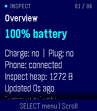

# Inspect

Inspect is a native, offline diagnostics app for the current **Core Devices
Pebble Time 2 (`emery`, 200×228)**. Version 0.1.1 uses public stock-firmware APIs.
It needs no phone companion, AWS backend, account, or subscription to run.

## Development paused

Development is paused at **v0.1.1** at Edward's request. We will resume when
the PT2 / PebbleOS developers expose supported system diagnostics to watchapps.
Inspect's own heap readings do not fulfill the intended whole-watch monitor.

Upstream feature request: [coredevices/PebbleOS#2509 — read-only system memory
and storage diagnostics for PT2](https://github.com/coredevices/PebbleOS/issues/2509).
The proposal asks maintainers about a built-in diagnostics page/report or a
supported SDK surface; it does not commit this project to a firmware fork.

| Metric | Stock Inspect |
| --- | --- |
| Inspect heap used/free/total | Available |
| Kernel heap used/free | Not exposed |
| Overall watch RAM usage | Not exposed |
| Other apps' memory or CPU usage | Not exposed |

The same public-API limitation prevents a reliable whole-watch filesystem
`Size / Used / Avail / Use%` view. The existing app, tests, build artifacts and
[firmware roadmap](docs/firmware-roadmap.md) are retained for future work.
Before resuming, verify that the required APIs exist in a released SDK and
compatible PT2 firmware; development-source internals alone are insufficient.

## Current app



Six button-operated screens provide:

- **Overview:** reported battery and charger state, phone connection, Inspect
  heap and sample age, with foreground scope clearly labelled.
- **Battery:** percentage, charging/plugged state, 48 retained observations
  with segment boundaries, and a conservative remaining-time estimate when
  the actual observations qualify.
- **Connection:** separate phone-app and PebbleKit states; foreground observed
  phone drops, connected/disconnected durations, sessions and recent events.
- **Inspect Memory:** this app's used percentage, used/free/total heap in KiB,
  exact byte counts and sampled peak since launch. Total = used + free;
  percentage = used / total. It is not whole-watch RAM utilization.
- **Device:** public model ID/name and three-part firmware version.
- **Capabilities:** supported readings and why deeper statistics are unavailable.

**Up/Down** scroll a screen. **Select** opens the screen menu; Up/Down choose
and Select opens. **Back** returns to the menu; Back from the menu exits.
No touchscreen action is required. The screenshots in `docs/screenshots/` are emulator captures,
including simulated charging/connection states used during testing.
Information text uses the larger 24-point system font; button hints use 18-point.
Long explanations and history remain scrollable.

## Honest limits

Inspect observes only while it has foreground focus. Closing it or losing focus
creates a gap. The app records session boundaries and never counts an absent
interval as connected time. Recovery from an interrupted session says its end
is unknown; that is not a watch reboot record.

Battery estimates require at least **three distinct observation timestamps,
two hours, and a three-percentage-point drop** in one continuous unplugged
segment. Charging, a reported rise, session change, backward clock change or a
gap longer than five minutes breaks the segment. A sample older than five
minutes is stale. Forecasts above 30 days are withheld. Estimates assume
similar future use; flat/coarse readings commonly leave insufficient data.
There is no extrapolation across closed periods. Small forward wall-clock
adjustments within the five-minute interval limit cannot be distinguished from
ordinary elapsed time with this implementation; the forecast remains a rough
estimate, not a reliable alarm or battery-health measurement.

Inspect does **not** measure watch-wide RAM, CPU utilization, free flash,
per-app storage/energy, sensor consumers, global wakeups, or reboot/crash
history. Those require firmware support. Heap values belong to Inspect;
the stock SDK cannot fill a `Filesystem / Size / Used / Avail / Use%` table.
Phone connection does not establish internet or notification health. Firmware
filters brief disconnects, so the event history and durations follow the SDK's
reported state rather than every radio outage. Opening
Inspect replaces the watchface and cannot measure that watchface's running cost.
See the full [ranked capability audit](docs/capabilities.md).

## Build and install

Verified: Pebble Tool **5.0.40**, watchapp SDK **4.33.1**, Ubuntu 22.04 x86_64.
The package's `sdkVersion: "3"` follows the current template metadata format.
See [setup and environment audit](docs/setup.md) for exact dependencies.

```sh
make                 # sanitizer host tests, Emery build, artifact audit
make emulator        # isolated localhost-only headless emulator
```

- Installable bundle: [pebble-inspect-0.1.1.pbw](artifacts/pebble-inspect-0.1.1.pbw)
- Checksum: [SHA-256](artifacts/pebble-inspect-0.1.1.pbw.sha256)
- [Install from AWS](docs/install.md): cloud developer connection, local PBW
  transfer, and trusted LAN/VPN alternatives. Cloud installation on Edward's
  PT2 succeeded after his explicit request; broader hardware checks remain pending.

Source: [ewijaya/pebble-inspect](https://github.com/ewijaya/pebble-inspect),
default branch `main`. Inspect v0.1.1 was sideloaded on Edward's PT2 through
the authorized cloud developer connection. No custom firmware was flashed.
The [GitHub Actions workflow](https://github.com/ewijaya/pebble-inspect/actions)
runs host tests and builds the stock Emery app.

## Development

See [architecture](docs/architecture.md), [test evidence and hardware checklist](docs/testing.md),
[firmware roadmap](docs/firmware-roadmap.md), and [project rules](AGENTS.md).
The firmware roadmap records possible upstream approaches for future reference.
Further implementation is deferred until supported system APIs become available
and Edward resumes the project. Kernel heap remains one allocation domain,
not all physical RAM.

UUID: `2de5b9f0-ee00-4a27-9474-5aacd231c6ac`.
Original app/icon code; reference repositories informed conventions without
copying their application code. SDK and firmware source retain upstream licenses.
